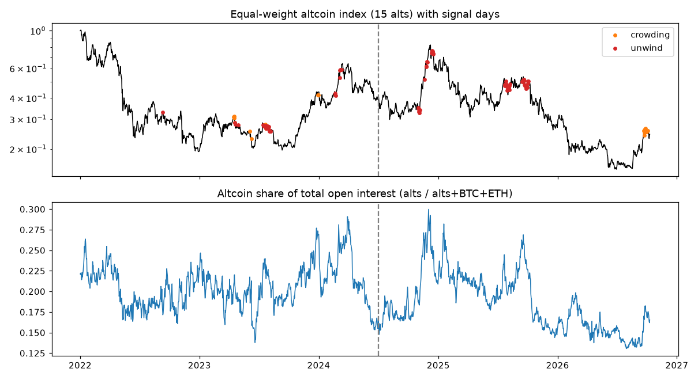

# alt-oi-signal

Research backtest of a simple **altcoin leverage-crowding / OI-unwind risk signal** built from
Binance USDT-M perpetual open interest (OI) and prices.

> **Research only, not financial advice.** Small sample, one exchange, one fixed basket of coins.
> The out-of-sample results below do **not** show a reliable edge.



## Question
When altcoin leverage gets crowded and then starts to unwind, are the next 30 days worse than a
random day? Measured on an equal-weight index of 15 large altcoins:
- **30-day forward max drawdown** (lowest close in the next 30 days vs. today)
- **30-day forward max gain** (highest close in the next 30 days vs. today)
- compared with **all days** in the same period (the "random day" baseline)

## Method
- **Data:** daily OI value (`metrics` archive) and daily closes for BTC, ETH and 14 altcoins
  (SOL, XRP, DOGE, ADA, AVAX, LINK, DOT, LTC, BCH, ATOM, FIL, ETC, NEAR, UNI) from
  [data.binance.vision](https://data.binance.vision). Bundled as `data/daily.csv` (~0.7 MB).
- **Signal 1 – crowding:** altcoin share of total OI (alts / alts+BTC+ETH) has its 30-day change in
  the top percentile of the past year, while BTC is range-bound.
- **Signal 2 – unwind:** alt index near its 90-day high, alt OI recently outran alt price by a margin,
  and alt OI has now dropped from its 14-day max.
- **No look-ahead:** percentiles use past data only; forward windows that run past the data end are dropped.
- **Events** are de-duplicated (a new event needs a 30-day gap).
- **Train / test split:** parameters are grid-searched on **2022-01 → 2024-06** only (objective:
  how much deeper the median drawdown is than baseline, minimum 4 events), then frozen and evaluated on
  **2024-07 → 2026-09** (out-of-sample).

## Results (as computed by `scripts/run_backtest.py` on the bundled data, last day 2026-10-10)

| Signal | Period | Events | Median 30d max drawdown | Baseline | Median 30d max gain | Baseline |
|---|---|---|---|---|---|---|
| crowding | train | 4 | -20.9% | -11.2% | +3.0% | +10.0% |
| crowding | **test** | **0** | n/a | -10.0% | n/a | +9.5% |
| unwind | train | 4 | -11.8% | -11.2% | +0.7% | +10.0% |
| unwind | **test** | **3** | -13.0% | -10.0% | +10.0% | +9.5% |
| either | **test** | **3** | -13.0% | -10.0% | +10.0% | +9.5% |

Selected parameters: crowding `(pct ≥ 0.95, BTC move < 12%)`, unwind `(near ≥ 0.85, gap > 0.2, ebb ≥ 5%)`.

**Reading it honestly**
- In-sample the crowding signal looked good (all 4 events fell ≥15%), but it **never fired** out-of-sample.
- The unwind signal fired 3 times out-of-sample (2024-10-31, 2025-07-23, 2025-09-15). Median drawdown
  was a bit deeper than baseline, but the median max gain was no lower, and dropping the worst 2 events
  leaves -6.8%. Three events is far too few to conclude anything.
- The crowding signal **did fire in late Sep / early Oct 2026** (orange dots at the right of the chart), after the test window ends; those days have no complete 30-day outcome yet, so they are not scored.
- Conclusion: **not useful as a trading rule** on this evidence; at most a "check your leverage" prompt.

## Run it
```bash
pip install -r requirements.txt
python scripts/run_backtest.py          # prints the table, writes results.json and docs/chart.png
pytest -q                               # unit tests + an end-to-end run on the bundled data
python scripts/fetch_data.py --start 2021-12-01   # optional: rebuild data/daily.csv from Binance (slow, many files)
```

## Layout
```
altoi/signal.py         features, signals, event de-duplication, stats, backtest
scripts/run_backtest.py CLI: results + chart
scripts/fetch_data.py   rebuild the dataset from data.binance.vision (no API key)
data/daily.csv          bundled daily OI value + close, 2021-01 → 2026-10
tests/                  pytest suite
```

## Limitations
Binance OI history starts in Dec 2021; fixed survivor basket (coins that still trade); one venue;
no funding-rate filter; tiny event counts. Ideas: dynamic top-N universe, multiple venues, permutation tests.

License: MIT
